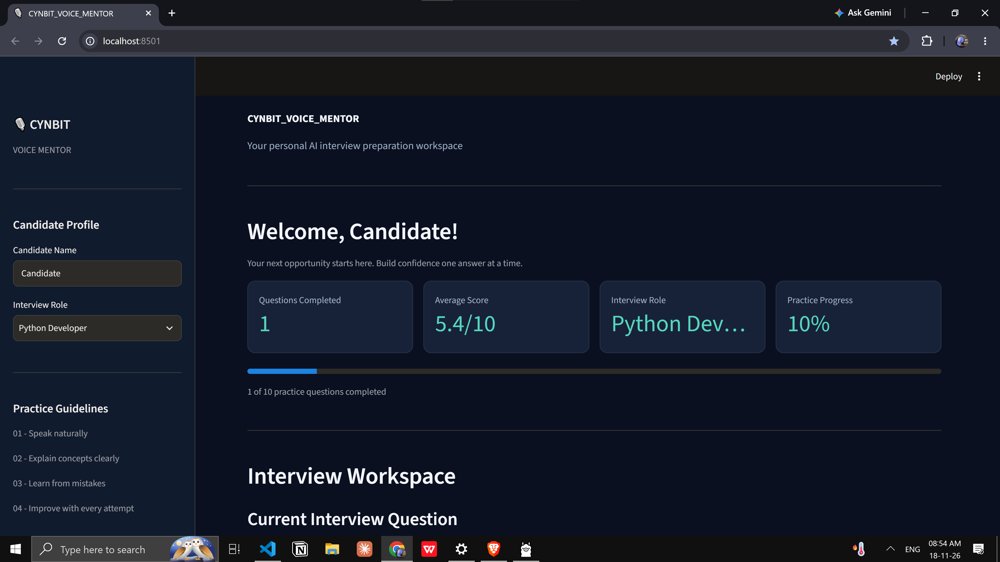
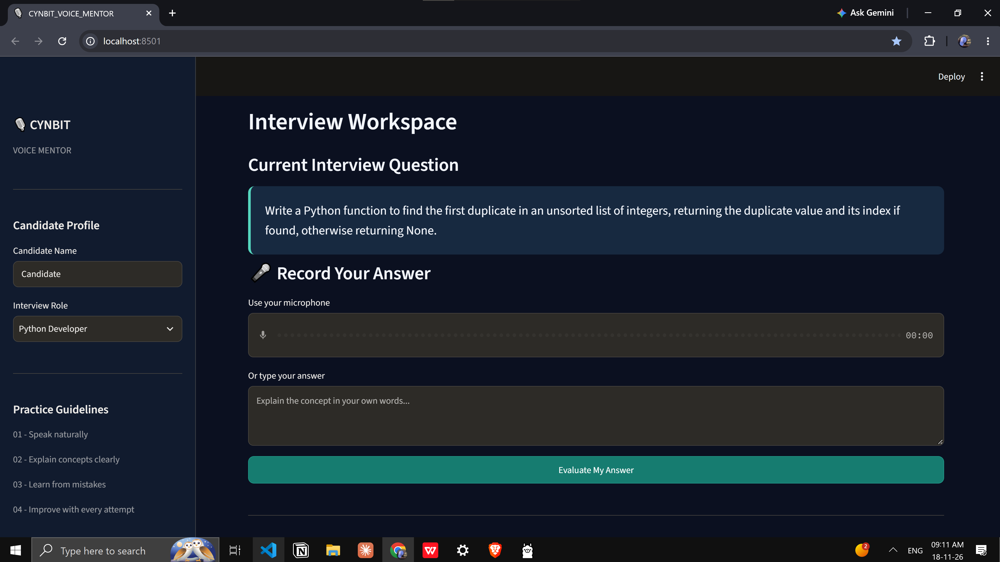

# CYNBIT VoiceMentor
### Local LLM-Powered Voice & Text Interview Assistant

**An AI-powered technical interview practice application built with Python, Streamlit, Ollama and Llama 3.2.**

CYNBIT VoiceMentor helps candidates practise technical interviews through interactive voice and text-based sessions. It generates role-specific interview questions, evaluates candidate responses and provides structured feedback to help improve technical understanding and communication.

The application uses a locally running LLM through Ollama, with a speech-to-text pipeline for voice-based interaction.

---

## Project Overview

| Attribute | Details |
|---|---|
| Project | CYNBIT VoiceMentor |
| Domain | Applied AI / LLM Applications |
| Programming Language | Python |
| Application Framework | Streamlit |
| LLM Runtime | Ollama |
| Language Model | Llama 3.2 |
| Speech Recognition | Faster-Whisper |
| Voice Output | Browser Speech Synthesis |
| Inference | Local LLM Inference |

## Key Technical Features

**1. Role-Based Interview Question Generation**
- Generates technical interview questions based on the selected job role.
- Uses Llama 3.2 through Ollama for question generation.
- Supports an interactive interview workflow.

**2. AI-Based Answer Evaluation**
- Evaluates candidate responses using a structured evaluation prompt.
- Assesses technical correctness, conceptual understanding, communication clarity and answer completeness.
- Generates strengths, improvement suggestions and improved sample answers.

**3. Voice-Based Interaction**
- Captures candidate responses through microphone input.
- Uses Faster-Whisper for speech-to-text transcription.
- Provides spoken feedback through browser speech synthesis.

**4. Performance Dashboard**
- Displays interview progress and evaluation scores.
- Presents feedback after each response.
- Maintains interview history within the application session.

## System Architecture

```text
             Candidate
                 |
                 v
        Streamlit Application
                 |
          Select Interview Role
                 |
                 v
        Question Generation
                 |
                 v
          Ollama / Llama 3.2
                 |
                 v
        Interview Question
                 |
          +------+------+
          |             |
          v             v
      Text Input    Voice Input
                        |
                        v
                 Faster-Whisper
                        |
                        v
                 Transcribed Text
          |             |
          +------+------+
                 |
                 v
          Answer Evaluation
                 |
          Ollama / Llama 3.2
                 |
                 v
          Structured Feedback
                 |
       +---------+---------+
       |                   |
       v                   v
 Performance Dashboard   Voice Feedback
```

## Answer Evaluation Framework

The application uses four evaluation dimensions:

| Evaluation Dimension | Weight |
|---|---:|
| Technical Correctness | 35% |
| Concept Understanding | 25% |
| Communication Clarity | 20% |
| Answer Completeness | 20% |

The overall score is calculated using a weighted scoring approach.

**Scoring formula:**

```python
overall_score = (
    technical_correctness * 0.35 +
    concept_understanding * 0.25 +
    clarity * 0.20 +
    completeness * 0.20
)
```

The evaluation scores are LLM-generated estimates based on the evaluation prompt and are intended for practice, not validated recruitment decisions.

## Technology Stack

| Technology | Application |
|---|---|
| Python | Application logic and integration |
| Streamlit | Interactive user interface |
| Ollama | Local LLM execution |
| Llama 3.2 | Question generation and answer evaluation |
| Faster-Whisper | Speech-to-text transcription |
| Speech Synthesis API | Spoken feedback |
| JSON | Structured AI evaluation output |

## Project Structure

```text
CYNBIT-VoiceMentor/
│
├── app_local.py
├── requirements.txt
├── README.md
├── .gitignore
│
└── screenshots/
    ├── dashboard.png
    ├── interview.png
    └── evaluation.png
```

## Installation and Execution

### Prerequisites

- Python installed
- Ollama installed
- Llama 3.2 model downloaded
- Microphone access for voice interaction

### 1. Clone the repository

```bash
git clone https://github.com/YOUR_USERNAME/CYNBIT-VoiceMentor.git
cd CYNBIT-VoiceMentor
```

### 2. Create a virtual environment

```bash
python -m venv .venv
```

Activate on Windows:

```bash
.venv\Scripts\activate
```

### 3. Install dependencies

```bash
python -m pip install -r requirements.txt
```

### 4. Download the local language model

```bash
ollama pull llama3.2
```

Verify the model:

```bash
ollama list
```

### 5. Launch the application

```bash
streamlit run app_local.py
```

Open the application at:

`http://localhost:8501`

Ollama must be running locally while using the application.

## Application Screenshots

### 1. Candidate Dashboard



### 2. Interview Practice



### 3. AI Evaluation and Feedback

)


## Future Improvements

- Improve interview evaluation accuracy and consistency.
- Add more technical interview categories and roles.
- Enhance voice interaction and feedback.
- Add performance tracking across interview sessions.
- Support additional local LLM models.

## Author

**Amirtha Janarthanan**

M.Sc. Data Science | Automotive Data Analyst | ML Engineer Candidate

GitHub: [amirthajanarthanan-ux](https://github.com/amirthajanarthanan-ux)

---

**Project Focus:** Applied Machine Learning | Local LLM Integration | NLP | Speech Recognition | Python Application Development

*Built to explore practical applications of locally running language models and voice-based AI systems.*